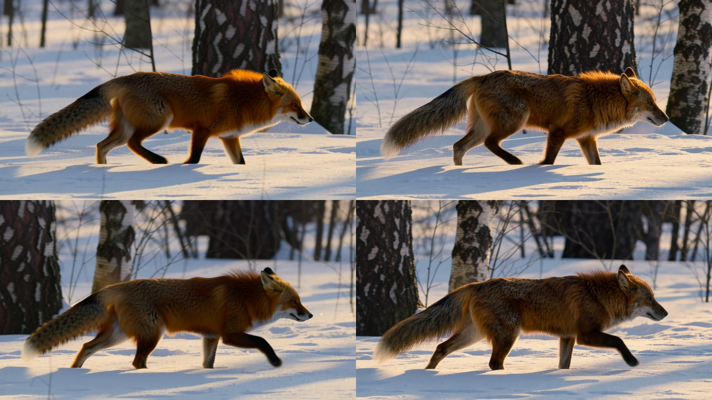
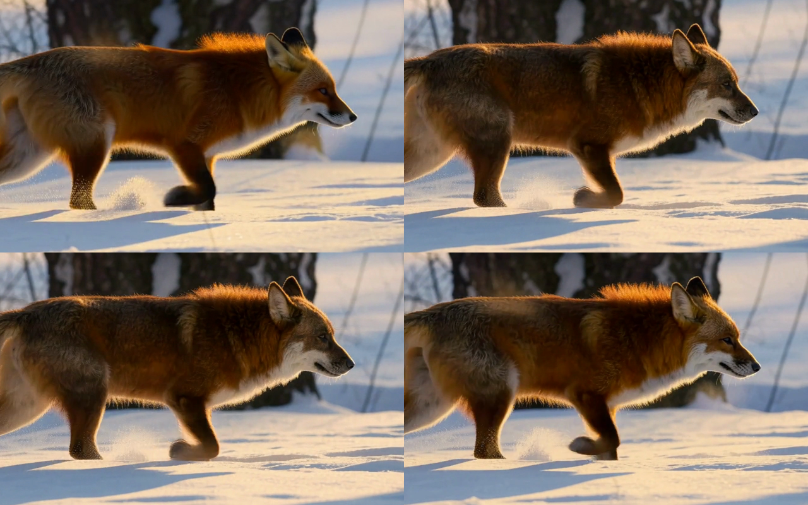

# ComfyUI-Open-H3-Regenerate

ComfyUI nodes and workflows for NVIDIA's **[Open-H3-Regenerate-2K](https://nvlabs.github.io/Sana/Open-H3-Regenerate-2K/)**,
the open replacement for the closed MiniMax H3-Regenerate-2K API. It takes a low-resolution draft (an H3 768P render, or
a 384P–576P clip from LTX, Wan, SANA-Video…) and regenerates it **natively at 768P, 1080P, 2K or 4K in three diffusion
steps**, on ComfyUI's native MiniMax H3 model.

```
draft ─► H3 VAE encode ─► H3-Latent-Upscaler (LBH 3D) onto the target grid
      ─► re-noise to σ 0.909375 ─► 3 Euler steps (0.909375 → 0.857 → 0.667 → 0), CFG 1
         FL2VA + merged LoRA (refiner + LightX2V FL2VA Turbo + LMS Sharp) + 50 Sharp curve branches,
         audio held as encoded silence
      ─► fast H3 VAE decoder (StreamRender-H3)
```

The pipeline follows NVIDIA's reference code
([NVlabs/Sana, `models/Open-H3-Regenerate-2K`](https://github.com/NVlabs/Sana/tree/sol-engine/models/Open-H3-Regenerate-2K)).
It also adds **Video to H3 Prompt**, which writes an H3 prompt for any clip with a vision model on your own
OpenAI-compatible server.

## Install

```bash
cd ComfyUI/custom_nodes
git clone https://github.com/rdh9616/ComfyUI-Open-H3-Regenerate
```

Also install [Comfyui_Minimax_h3_latent_Upscaler](https://github.com/LBH-123-AI/Comfyui_Minimax_h3_latent_Upscaler)
(the latent upscaler node). Restart ComfyUI. Needs ComfyUI with native MiniMax H3 support (tested on 0.42.0).

### Models

| File | Put it in | Download |
|---|---|---|
| `open_h3_regenerate_2k_lora.safetensors` (12.4 GB) | `models/loras/` | [Efficient-Large-Model/Open-H3-Regenerate-2K](https://huggingface.co/Efficient-Large-Model/Open-H3-Regenerate-2K/tree/main/lora) `lora/` |
| `sharp_curve_branches.safetensors` (1.2 GB) | `models/loras/` | same, `lora/` |
| `fast_h3_vae_noncausal_24l.safetensors` (6.5 GB) | `models/vae/` | same, `vae_fast/` |
| `minimax_h3_latent_upscaler_3d_conv_v1_*` | `models/latent_upscale_models/` | same, `latent_upsampler/` (or LBH-123-AI's release) |
| MiniMax H3 **FL2VA** model (any variant; the reference base is FL2VA) | `models/diffusion_models/` | [Comfy-Org/MiniMax-H3](https://huggingface.co/Comfy-Org/MiniMax-H3) |
| a **pruned ref2va** checkpoint (only its 32 KB `adaln_t_table` is read) | `models/diffusion_models/` | Comfy-Org/MiniMax-H3, e.g. `minimax_h3_ref2va_pruned_int8_convrot` |
| H3 video + audio VAE, Qwen3-VL text encoder | as usual | Comfy-Org/MiniMax-H3 |

No weights are re-hosted here. The nodes read NVIDIA's files as published and convert them at load time, and every
file keeps its own license. NVIDIA's adaln table is base-derived and they chose not to redistribute it, so the LoRA
node reads it from a checkpoint you already have.

## Nodes (category *MiniMax H3/Open-H3 Regenerate*)

| Node | What it does |
|---|---|
| **LoRA (refiner + Turbo + Sharp)** | Loads NVIDIA's merged Diffusers LoRA (rank 576, FP32) onto ComfyUI's H3. `to_q/k/v` become row slices of `qkv_proj`, `to_out.0` becomes `out_proj`, `ff.net.2` becomes `fc2`, and `ff.net.0.proj` becomes `fc1` with its halves swapped (Diffusers `[value; gate]` → ComfyUI `[gate; value]`). This mapping was verified bit-exactly against the Diffusers base and Comfy-Org's bf16 checkpoint. The node also installs LMS Sharp's 50 AdaLN curve branches, `B·A·curve(t)`, which read the reference `adaln_t_table`. |
| **Sigmas** | The 3-step release grid, the 2-step grid (0.7, 0.494, 0), or the refiner's shift-6 grid from any `start_sigma`. |
| **Prepare Draft** | Resamples the draft to 24 fps, cover-scales and centre-crops it to 1344×768 or 1024×576 (portrait drafts get portrait sizes), cuts it to `max_frames`, and holds the last frame up to H3's 17k+5 frame grid. |
| **Latent Upscale (LBH 3D)** | Runs the H3 latent upscaler straight onto the target grid. 1080P computes 1920×1088. 4K runs two passes, via 2K. Audio in an AV latent passes through. |
| **Refine Latent** | The AV latent for the refine. The video is re-noised by the sampler; the audio is masked, so ComfyUI keeps it clean at model time 1 (the reference's "audio σ = 0"). The audio is encoded silence by default, or the draft's own soundtrack. |
| **Fast VAE Decode (StreamRender-H3)** | NVIDIA's fast H3 VAE decoder: the released 36-layer decoder pruned to 24 layers and distilled. It runs NVIDIA's plain-PyTorch path (`fast_vae_decoder.py`, vendored unchanged) through a memory-lean forward (`fast_vae_lean.py`, tested equal to the reference). |
| **Finish Frames** | Trims the padding frames, crops 1088 → 1080 and 2176 → 2160 rows, and cuts the soundtrack to match. |
| **Video to H3 Prompt (inference server)** | Sends a clip to a vision model on an OpenAI-compatible server (vLLM, SGLang, llama.cpp, LM Studio) as a small 4 fps H.264 video, or as 8 stills. Returns an H3 text-to-video prompt: `integrated_multimodal_description` (`[Shot N]` per take) + `overall_soundscape` + `non_diegetic_music`. |

### How the Sharp curve branches are applied
LMS Sharp adds a delta to each block's AdaLN projection that depends on the model time *t* through an 8-D curve
(`adaln_t_table` of Comfy-Org's ref2va pruned checkpoint, sha256 `c02a6c11…`). The node gets *t* in one of three ways:
* **Pruned model with that same table** (e.g. ref2va pruned): the AdaLN input already *is* the curve, so the delta is added directly.
* **Pruned model with its own table** (e.g. `minimax_h3_fl2va_pruned_*`): *t* is read back from the model's own curve, exact to about 1e-8.
* **Full model with a time embedder:** *t* is recorded from the time embedder.

Only `forward` is replaced. The modules keep their weights, so ComfyUI's casting, offloading and other LoRAs work unchanged.

### Video to H3 Prompt: keys and TLS
* The API key is read at run time from an **environment variable** named in `api_key_env` (default `H3_LLM_API_KEY`).
  It never goes into the workflow or into saved PNG/MP4 metadata. On Windows, if the ComfyUI process didn't inherit
  the variable (for example, it was started by a launcher that was already open), the node reads it from the saved
  user or system environment.
* HTTPS certificates are always verified, against the system trust store or a `ca_file` you give.
* Text in `manual_prompt` is passed through and the server is not called. Change `seed` for another variant.

## Workflows (`example_workflows/`)

| Workflow | Use it for |
|---|---|
| **Open-H3 Regenerate 2K - Draft Video** | A finished draft regenerated at 2560×1440. The prompt is written by *Video to H3 Prompt*. Set `server_url`, or paste your own prompt into `manual_prompt`. |
| **Open-H3 Regenerate 2K - Prompt to 2K** | A prompt turned into an H3 768P draft (FL2VA + LightX2V Turbo 4-step, 6 steps er_sde), then into 2K, in one run. |

Defaults follow NVIDIA's recipe: merged LoRA at 1.0 + curve branches · LBH upscaler in bf16 · σ 0.909375 → 0.857 →
0.667 → 0 · Euler · CFG 1 · seed 1766580932 · 121 frames (5 s) · `768p` input size (`576p` for drafts from other
models). ComfyUI's built-in *Model Sparse Attention* (Sol-Attn) is **on**, and all three steps run sparse, as in
SoL-Engine.

## Speed (RTX PRO 5000 Blackwell 72 GB, Windows, ComfyUI 0.42)

5 s clip (121 frames), 768P → 2560×1440, int8 FL2VA pruned base:

| Configuration | Refine (3 steps) | VAE decode | Whole run |
|---|---|---|---|
| Workflow defaults: Sol-Attn + fast VAE decoder | **122 s** | **24 s** | **≈ 3 min** warm (206 s cold) |
| Sol-Attn + ComfyUI's own VAE decode | 122 s | 50 s | ≈ 3.5 min |
| Dense attention + ComfyUI's own VAE decode | 474 s | 50 s | ≈ 9.5 min |
| Prompt → 768P draft (6 × 16 s) → 2K, defaults | 122 s | 24 s | ≈ 5 min |

* Sol-Attn and dense output look the same (34.6 dB PSNR between them).
* The fast decoder's output is 37.8 dB from ComfyUI's decoder, with no visible difference. Alone it takes 12 s at
  1080P and 22 s at 2K, with a 29 GB peak.
* NVIDIA's reference forward of the fast decoder peaks at about 71 GB at 2K. On a 72 GB card it spills into system
  RAM and takes 113 s, which is why the lean forward exists.
* An NVFP4 base saved only 9% of the refine time and visibly lost skin and moss detail.
* SoL-Engine's MXFP8, CUDA graphs and FlashAttention-4 decoder engine need NVIDIA's Linux runtime and are not used.

## Results and a caveat

On NVIDIA's own demo draft (the glass mushroom from the project page), the 2K output with the defaults closely matches
their published result: the same new skin texture and the same reflections in the glass.

At σ 0.909 the refine redraws a lot. In one test a small fox face drifted toward a wolf (darker coat, lost ear tips)
while layout and motion held. This was not caused by the Sharp curve branches: it also happened with them off. It
also happened with decode → re-encode in place of the latent hand-off. **`start_sigma` 0.8** stays closer to the draft.




## Kijai's refiner LoRA

[Kijai/MiniMax-H3-experimental](https://huggingface.co/Kijai/MiniMax-H3-experimental/tree/main/loras) publishes
`minimax_h3_open_regenerate_2k_refiner_rank_384_bf16.safetensors`: ranks 0–383 of NVIDIA's merge (the refiner only),
in ComfyUI keys for the standard LoRA loader. To match the reference with it you also need LightX2V Turbo v1.2 and
LMS Sharp, including its curve branches. This pack's LoRA node loads NVIDIA's full merge and the curve branches in one
step. Kijai's conversion (q|k|v fused, SwiGLU halves swapped) matches this pack's.

## Tests

```bash
python -I tests/test_core.py [lora_header.json] [pruned_checkpoint.safetensors]
<ComfyUI python> tests/test_comfy_nodes.py <ComfyUI dir> <scratch dir>
```
The tests cover:
* the sigma grids, the frame math and the 312-module key map;
* curve-time inversion on real tables;
* on tiny native H3 models (full and curve-form): patched weights equal W + B·A, AdaLN output equals the reference
  formula, and unpatching restores all weights;
* the lean fast-VAE forward against NVIDIA's forward on 5 shapes;
* the prompt node's response cleanup, key handling and media encoding.

## Credits

* [Open-H3-Regenerate-2K](https://nvlabs.github.io/Sana/Open-H3-Regenerate-2K/), SoL-Engine and StreamRender-H3: Sensen Gao, Haozhe Liu et al., NVIDIA. `fast_vae_decoder.py` is NVIDIA's code (Apache-2.0).
* [MiniMax H3](https://huggingface.co/MiniMaxAI/MiniMax-H3) (MiniMax H3 Community License) and Comfy-Org's ComfyUI integration.
* [H3 latent upscaler](https://github.com/LBH-123-AI/Comfyui_Minimax_h3_latent_Upscaler) (LBH-123-AI), [LightX2V](https://github.com/ModelTC/LightX2V) FL2VA Turbo, [LMS Sharp](https://huggingface.co/Alissonerdx/Minimax-H3-ComfyUI) (Alissonerdx).

Code in this repository: Apache-2.0 (see `LICENSE` and `NOTICE`). Model weights: their own licenses.
