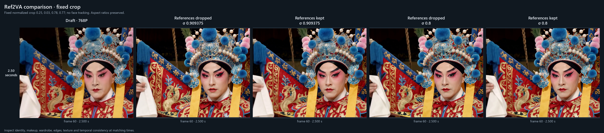

# Ref2VA to 2K

Open **Open-H3 Regenerate 2K - Ref2VA to 2K** from `example_workflows/` to generate
a reference-conditioned draft and regenerate it at 2560 × 1440 in one workflow.
It requires ComfyUI's native **MiniMax H3 Reference to Video** node and the
Open-H3 Regenerate and LBH latent-upscaler packs listed in the main README.

## Inputs and prompts

1. Upload an image in **<Picture 1> reference**. `reference.png` is a placeholder;
   no reference media is distributed with the workflow.
2. Edit the draft prompt to describe your subject, action and scene. Its
   `<Picture 1>` tag refers to the connected image. The example describes a fox.
3. Edit the descriptive refine prompt to describe the same subject and scene
   directly. It is encoded separately without images, video, audio or reference
   tags. Removing reference-latent metadata from the draft conditioning would
   still leave the references in its text-encoder embeddings.
4. Check the saved 768P draft before judging the 2K result. Both videos use the
   draft's generated soundtrack.

The native **MiniMax H3 Reference to Video** node accepts more inputs as needed:

| Reference | Connection | Prompt label |
|---|---|---|
| Image | An image loader into a growing image input | `<Picture N>` |
| Video | Frames at 24 fps into a video input | `<Video N>` |
| Video soundtrack | Audio into the matching video-audio input | `<Audio N>` |
| Standalone audio | An audio loader into an audio input | `<Audio N>` |

References are presented in image, video and standalone-audio order; a video's
soundtrack receives its audio label before that video. Keep the labels in your
draft prompt aligned with the native node's reference ordering. The video and
audio VAEs are already connected.

## Models and sampling

The draft and refine have **separate model loaders**. The example uses
`minimax_h3_fused_refdelta_r1024_turbo8_mystic07_int8_convrot.safetensors` for the
Ref2VA draft: Turbo is already merged, so it uses 8 `er_sde` steps, the `simple`
schedule and CFG 1, with no additional Turbo LoRA. Select a Ref2VA model you have
installed and use its matching sampling settings if you use a different model.
The FL2VA Turbo LoRA from the Prompt to 2K example is not applied to this draft.

That checkpoint is the locally installed fused preset used for these tests.
This repository does not include or download it. The supplied eight-step
settings apply to that preset; other Ref2VA checkpoints were not validated in
this comparison.

### Which model goes where?

| Role | Model |
|---|---|
| 768P draft loader | Ref2VA. The supplied settings were tested with the fused turbo8 preset above. |
| 2K refine loader | FL2VA with the released Open-H3 merged LoRA and Sharp curves. |
| Curve-table file inside the LoRA node | The pruned Ref2VA checkpoint; only its `adaln_t_table` is read. This does not change the refine model to Ref2VA. |

`minimax_h3_ref2va_pruned_int8_convrot.safetensors` is a Ref2VA-family checkpoint
for the draft role, but its sampling recipe was not tested here. Do not assume
the fused preset's eight-step settings also apply to that base checkpoint.
Replacing the FL2VA refine base with Ref2VA is outside this example's validation.

This workflow combines a reference-conditioned draft with FL2VA regeneration;
it does not provide a Ref2VA-trained regeneration adapter. In the linked
[upstream Ref2VA request](https://huggingface.co/Efficient-Large-Model/Open-H3-Regenerate-2K/discussions/9),
Gao Sensen said on 2026-11-04 that the model was forthcoming. That reply does not
establish compatibility of the existing FL2VA refiner with a Ref2VA base.

The draft is 1344 × 768 with 124 frames at 24 fps, about 5.17 seconds. Refinement
uses FL2VA, the merged Open-H3 refiner/Turbo/Sharp LoRA and Sharp curves, the LBH
latent upscaler, Sol-Attn, 3 Euler steps and CFG 1. The selected default is
**fresh text-only refine conditioning and `start_sigma=0.8`**, which redraws less
of the draft. A value of zero restores the release schedule beginning at 0.909375.

Reference blocks use their own spatial grids, unlike first/last keyframes. This
does not establish that keeping references in an FL2VA refine preserves identity
better. The comparison below evaluates full reference conditioning against a
fresh descriptive text-only encoding.

## Soundtrack and recovery

The refiner holds its internal audio latent as encoded silence. The final video
receives audio decoded from the **generated Ref2VA draft**, not a copy of an
input reference recording. The same soundtrack is saved with the refined latent.
Use **Decode Saved Latent** if video decoding fails after refinement.

## Validation and comparison

Tested on 2026-11-02 with an RTX PRO 5000 Blackwell 72 GB, Windows and the native
ComfyUI H3 nodes. The reference was the first frame of NVIDIA's public
[C026 Peking opera demo](https://huggingface.co/datasets/Efficient-Large-Model/Sana-assets/resolve/main/Open-H3-Regenerate-2K/assets/sol-engine/us/C026-input.mp4).
One newly generated 1344 × 768 draft, its soundtrack and the same refine seed
(1766580932) were reused for all four comparisons. The retained-reference variants
use the native Ref2VA node's complete conditioning; the dropped-reference variants
use a separately encoded descriptive prompt without media.

| Refine conditioning | Starting sigma | Measured execution time | Scope |
|---|---|---|---|
| Text only | 0.909375 | 463.4 s (7m43s) | Full workflow: draft, refine and save; first model initialization |
| References kept | 0.909375 | 179.0 s (2m59s) | Reused draft, model already loaded |
| Text only | 0.8 | 282.8 s (4m43s) | Reused draft, model already loaded |
| References kept | 0.8 | 293.3 s (4m53s) | Reused draft, model already loaded |

These are single-run wall times, not equivalent cold/warm benchmarks. All four
completed with 124 frames at 2560 × 1440 and 24 fps. Their decoded soundtracks are
identical to each other. The finish node trims the generated audio to the video
length; the draft and final soundtrack match exactly over the first four seconds.

Attention settings are held fixed. With the release schedule, eligible attention
blocks use Sol-Attn in all three steps. At `start_sigma=0.8`, the final evaluation
is at sigma 0.48, below the configured sparse cutoff (about 0.5714), and runs
dense. Runtime and visual differences between schedules therefore include this
automatic attention change.

At the sampled frames, 0.8 retains more of the draft's headdress structure. Keeping
reference conditioning offers no clear improvement here. Every variant still
changes facial details. This is one clip and seed, with no general identity or
temporal-quality guarantee. Text-only refinement at 0.8 was selected as the
shipping default.

[Full-frame comparison at 0.5, 2.5 and 4.5 seconds](ref2va_comparison.png).
The figures contain generated results only, derived from the public demo reference.

The workflow imported without missing node classes and completed end to end.
Core tests, tiny native-model CPU checks and workflow routing checks passed;
seven mutations confirmed the checks reject conditioning, model and soundtrack
regressions. The finalization also sets Draft Video and Prompt to 2K to 0.8 and
updates their notes. Decode Saved Latent is unchanged. The November 2 GPU results
above remain the measured evidence; changing these defaults did not rerun them.
